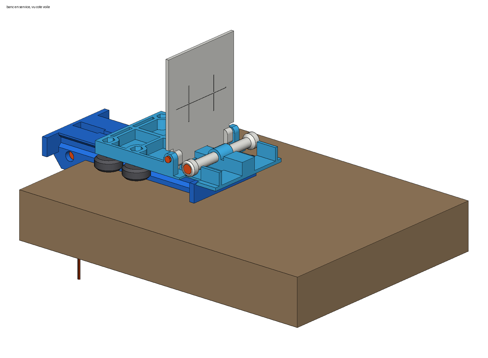
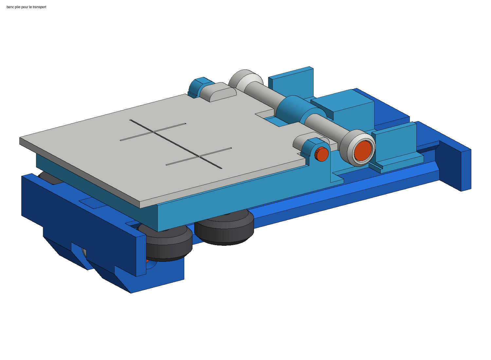
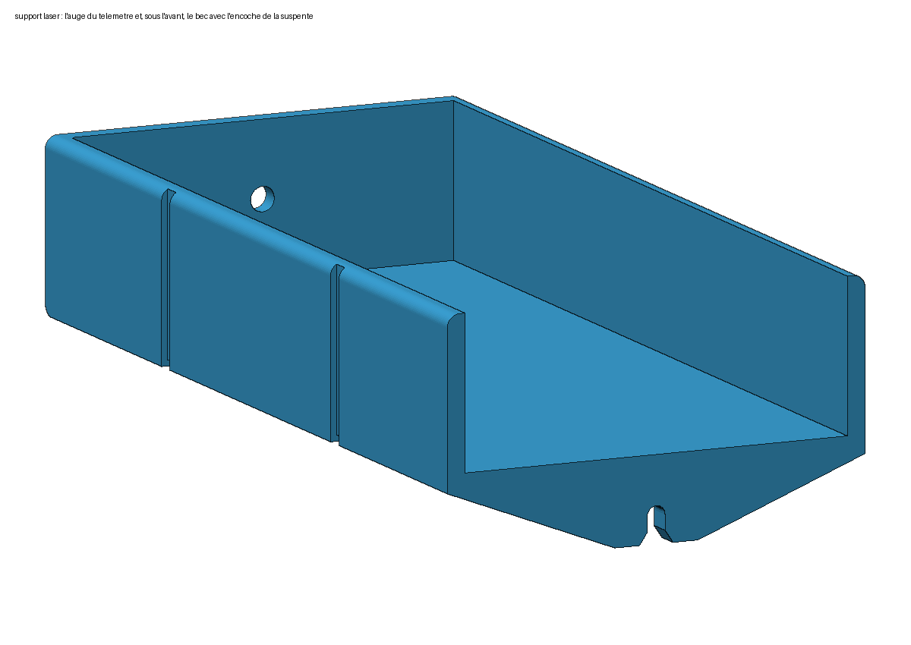

# Banc de calage parapente

[English version](README.en.md)

> **Avertissement** : un premier exemplaire de ce banc a été imprimé et essayé par son auteur ;
> ces essais restent limités et ne valent ni certification ni validation par un atelier. Le banc
> est fourni gratuitement, sans garantie dans les limites permises par la loi, et s'utilise aux
> risques de l'utilisateur ; cela n'exclut ni la responsabilité pour les dommages corporels, ni
> celle du fait des produits défectueux, ni celle due au dol ou à la faute lourde. Le calage d'une aile doit respecter les valeurs et les procédures de son
> constructeur, et une erreur de mesure peut modifier le comportement de l'aile en vol : faites
> contrôler tout recalage par un atelier qualifié.
>
> **Risque de chute** : le banc ne tient sur la table que par la traction de la suspente.
> Suspente relâchée, ou tirée trop vers le haut, la poche de 5 kg le fait basculer et il tombe
> avec elle. Réglez la cordelette pour que la poche repose au sol dès que la suspente mollit, et
> ne laissez personne sous la poche.

Pour vérifier le calage de sa voile, il faut mesurer chaque suspente sous la même tension.
Ici, deux pièces imprimées en 3D font le travail avec un télémètre laser et une poche à eau
de 5 L : un **banc** qui se pose sur le bord d'une table et tend la suspente à 5 kg, et un
**support de laser** qui coince la patte de la suspente côté voile. Quincaillerie : ≈ 15 €,
plus le port.

| Le banc, suspente tendue | Plié : 164 × 93 × 52 mm | Le support du laser et son encoche |
|---|---|---|
|  |  |  |

## Comment ça marche

- Le banc s'accroche au bord de la table. Les deux **élévateurs** se posent à plat dessus,
  chacun sur une bobine ; on passe simplement la boucle du maillon par-dessus.
- Un chariot à roulettes relie les élévateurs, par une cordelette et une poulie, à la **poche
  à eau** qui pend sous la table. Tant que le chariot flotte entre ses butées, la suspente est
  tendue à ≈ 5 kg.
- Devant les élévateurs, une **cible blanche** se relève et se verrouille d'équerre.
- Côté voile, on glisse la suspente dans l'**encoche du support**, la patte vient en butée,
  et le laser couché dans le support vise la cible. L'outil de calage en ligne calcule les
  écarts, avec l'offset indiqué plus bas.
- Pour voyager : cible rabattue, une bande auto-agrippante autour.

## Fichiers à imprimer

Sept fichiers pour le banc, un par pièce, déjà orientés pour l'impression, sans support ;
puis le support du laser, dans la version de votre télémètre.

| Fichier | Pièce |
|---|---|
| `socle.stl` | le socle qui s'accroche à la table ([image](apercu/socle.png)) |
| `coulisseau.stl` | le chariot qui porte les élévateurs et la cible ([image](apercu/coulisseau.png)) |
| `cible.stl` | la cible, à imprimer en blanc ([image](apercu/cible.png)) |
| `poulie.stl` | la poulie de la cordelette ([image](apercu/poulie.png)) |
| `bobine_tete.stl`, `bobine_ecrou.stl` | les deux bobines des élévateurs ([image](apercu/bobine_tete.png)) |
| `entretoises_grappe.stl` | 8 petites entretoises sur une barrette, à détacher au cutter ([image](apercu/entretoises_grappe.png)) |

### Le support du laser, à la taille de votre télémètre

Même pièce ([l'encoche](apercu/support_laser_encoche.png), [vue de dessous](apercu/support_laser_bec.png)),
une version par télémètre : les Leica DISTO et les Bosch à moins de 500 €, aux cotes du
constructeur plus 0,5 mm de jeu. Le support est 3 mm moins haut que le télémètre, pour le
saisir et atteindre ses boutons. Certains télémètres ne mesurent que depuis leur face
arrière : leur lecture est plus longue de leur propre longueur, le tableau dit combien
retrancher. GLM 100, 120 et 150 : pointe arrière rentrée.

<!-- supports:debut -->
| Télémètre | Cotes constructeur (mm) | Repère de mesure | Fichier |
|---|---|---|---|
| Leica DISTO D1 | 115 × 43.5 × 23.5 | arrière seulement : retranchez 115 mm de la lecture | `support_laser_leica_d1.stl` ([image](apercu/support_laser_leica_d1.png)) |
| Leica DISTO D110 / E7100i | 120 × 37 × 23 | arrière seulement : retranchez 120 mm de la lecture | `support_laser_leica_d110.stl` ([image](apercu/support_laser_leica_d110.png)) |
| Leica DISTO D2 (v1, 100 m) | 116 × 44 × 26 | avant ou arrière | `support_laser_leica_d2_v1.stl` ([image](apercu/support_laser_leica_d2_v1.png)) |
| Leica DISTO D2 (2025, 150 m) / D2G | 127 × 50.5 × 24.5 | avant ou arrière | `support_laser_leica_d2_2025.stl` ([image](apercu/support_laser_leica_d2_2025.png)) |
| Leica DISTO X1 | 125 × 53.5 × 25.5 | arrière seulement : retranchez 125 mm de la lecture | `support_laser_leica_x1.stl` ([image](apercu/support_laser_leica_x1.png)) |
| Leica DISTO X3 / X4 | 132 × 56 × 29 | avant ou arrière | `support_laser_leica_x3_x4.stl` ([image](apercu/support_laser_leica_x3_x4.png)) |
| Bosch GLM 40 / GLM 30 | 105 × 41 × 24 | avant ou arrière | `support_laser_bosch_glm40.stl` ([image](apercu/support_laser_bosch_glm40.png)) |
| Bosch GLM 50-22 / 50-25 G / 50-27 C / 50-27 CG / 40-31 | 119 × 53 × 29 | avant ou arrière | `support_laser_bosch_glm50.stl` ([image](apercu/support_laser_bosch_glm50.png)) |
| Bosch GLM 80 | 111 × 51 × 30 | avant ou arrière | `support_laser_bosch_glm80.stl` ([image](apercu/support_laser_bosch_glm80.png)) |
| Bosch GLM 100-25 C / 150-27 C / 120 C | 142 × 64 × 28 | avant ou arrière | `support_laser_bosch_glm100_150.stl` ([image](apercu/support_laser_bosch_glm100_150.png)) |
| Bosch Zamo (IV, 2025) | 104 × 38 × 23 | arrière seulement : retranchez 104 mm de la lecture | `support_laser_bosch_zamo.stl` ([image](apercu/support_laser_bosch_zamo.png)) |
| Bosch PLM30-21 / EasyDistance 20 | 94 × 36 × 23 | arrière seulement : retranchez 94 mm de la lecture | `support_laser_bosch_plm30.stl` ([image](apercu/support_laser_bosch_plm30.png)) |
| Bosch PLM40-23 / 50-23 / 60-23C / 70-23C, UniversalDistance 30 / 40C / 50 / 50C, PLR 30 C / 40 C | 100 × 42 × 22 | avant ou arrière | `support_laser_bosch_plm40_70.stl` ([image](apercu/support_laser_bosch_plm40_70.png)) |
| Bosch PLM70-27 / AdvancedDistance 50C / PLR 50 C | 115 × 50 × 23 | avant ou arrière | `support_laser_bosch_plm70_27.stl` ([image](apercu/support_laser_bosch_plm70_27.png)) |
<!-- supports:fin -->

Autre télémètre : mesurez-le (largeur, longueur, épaisseur), reportez les trois cotes dans
`scad/support_laser.scad` et regénérez le STL ; `btn_cote` ouvre une paroi en face de boutons
latéraux.

## Quelle matière

**PETG**, 4 périmètres, 25 % de remplissage, cible en blanc mat. Pas de PLA si le banc
voyage en voiture : il se déforme au soleil.

Si vous faites imprimer chez [JLC3DP](https://jlc3dp.com/3d-printing-quote) : tout en
**nylon SLS 3201PA-F**, sauf la cible en **résine SLA 9000HE** blanche. Comptez ≈ 70 € pour
l'impression du banc. Les pièces serrées par des vis ou tirées par une suspente (socle,
chariot, support du laser) ne doivent pas être en résine : elle casse au lieu de plier.

**Moins cher, pour un banc qui reste à la maison** : chez JLC3DP, socle, chariot et support
du laser en **PLA** (dépôt de fil), les petites pièces en nylon, la cible en résine 9000HE.
Le PLA est rigide et tient bien les vis à température ambiante. Comptez ≈ 50 à 55 € au lieu
de 70 (estimation, à confirmer par le devis). Une seule règle : ne jamais laisser le banc dans
une voiture, le PLA se ramollit vers 60 °C. Une utilisation rare ne rend pas la résine
acceptable pour autant : elle casse au serrage des vis ou à la chute, pas à l'usure.

## Ce qu'il faut acheter

Rien que des vis, des écrous frein et des roues, en deux commandes en France : toute la
visserie à l'unité chez visseriefixations.fr ; aucun des sites européens examinés n'a aussi
les roues, elles viennent d'une boutique d'impression 3D. Prix lus le 8 octobre 2026, port
non compris (il ne s'affiche que dans le panier).

| Pièce | Référence du site | Il en faut | Prix | Lien |
|---|---|---|---|---|
| Roues V Ø 24 × 10 en POM, alésage 5, roulements 625ZZ montés | lot de 6 | 5 sur 6 | 12,90 € | [3delectroshop.fr](https://3delectroshop.fr/roulements-et-rotules/504-roulettes-v-slot-en-pom-avec-roulements-625zz.html) |
| Vis M5 × 25 tête bombée, ISO 7380, inox A2 (roues) | TBHC05/025A2 | 4 | 0,08 € pièce | [visseriefixations.fr](https://www.visseriefixations.fr/vis-a-six-pans-creux/tete-bombee-hexagonale-creuse/tbhc-inox-a2-iso-7380/tbhc-m5x25-inox-a2-iso-7380.html) |
| Vis M3 × 12 tête bombée, ISO 7380, inox A2 (charnière de la cible) | TBHC03/012A2 | 2 | 0,05 € pièce | [visseriefixations.fr](https://www.visseriefixations.fr/vis-a-six-pans-creux/tete-bombee-hexagonale-creuse/tbhc-inox-a2-iso-7380/tbhc-m3x12-inox-a2-iso-7380.html) |
| Vis M5 × 40 tête cylindrique, DIN 912, inox A2 (axe de la poulie) | TCHC05/040A2PF | 1 | 0,13 € | [visseriefixations.fr](https://www.visseriefixations.fr/vis-a-six-pans-creux/tete-cylindrique-hexagonale-creuse/inox-a2/tchc-inox-a2-filetage-partiel-din-912/tchc-m5x40-inox-a2-pf-din-912.html) |
| Écrous frein M3 à bague nylon, DIN 985, inox A2 | ECRNYL03A2 | 2 | 0,04 € pièce | [visseriefixations.fr](https://www.visseriefixations.fr/ecrous/ecrous-autofreines/ecrou-hexagonal-autofreine-nylstop/ecrou-nylstop-inox-a2-din-985/ecrou-nylstop-m3-inox-a2-din-985-17062-17062.html) |
| Écrous frein M5 à bague nylon, DIN 985, inox A2 | ECRNYL05A2 | 6 | 0,04 € pièce | [visseriefixations.fr](https://www.visseriefixations.fr/ecrous/ecrous-autofreines/ecrou-hexagonal-autofreine-nylstop/ecrou-nylstop-inox-a2-din-985/ecrou-nylstop-m5-inox-a2-din-985-99867-99867.html) |
| Vis M5 × 80 tête cylindrique, DIN 912, inox A2 (bobines) | TCHC05/080A2PF | 1 | 0,59 € | [visseriefixations.fr](https://www.visseriefixations.fr/vis-a-six-pans-creux/tete-cylindrique-hexagonale-creuse/inox-a2/tchc-inox-a2-filetage-partiel-din-912/tchc-m5x80-inox-a2-pf-din-912.html) |

**Visserie : 1,46 € ; roues : 12,90 € ; plus le port des deux commandes.** La cordelette est
n'importe quelle cordelette de 2 mm (reste de suspente, drisse, paracorde). Le roulement de la
poulie se récupère sur la cinquième roue, le lest est votre poche à eau, et il n'y a ni colle
ni frein-filet : tout se visse dans des trous de passage, avec un écrou frein au bout. Le
laser n'est pas compté : un télémètre Bluetooth de 30 m (HOTO QWCJY001 ou équivalent) vaut
30 à 40 €.

## Montage

Le schéma complet, avec la visserie : [schema_montage.png](apercu/schema_montage.png).

1. **Poulie** : sortez un roulement d'une roue en trop, emmanchez-le dans la poulie. Posez la
   poulie dans sa fente avec une entretoise de chaque côté. Glissez un écrou frein M5 dans son
   logement, sur un flanc du socle, passez la vis M5 × 40 par l'autre flanc et vissez (clé
   Allen de 4) jusqu'à ce que la tête porte, sans forcer. Tête et écrou restent sous les
   flancs.
2. **Roues** : un écrou frein dans chacun des 4 logements du chariot, puis pour chaque roue
   une vis M5 × 25 par le dessous, à travers la roue et une entretoise.
3. **Jeu** : serrez le côté fixe, poussez les deux autres roues au fond de leur rainure (trous
   oblongs), serrez. Le chariot doit rouler tout seul quand on incline le socle.
4. **Bobines** : sur la vis M5 × 80, une bobine, la nervure du chariot, l'autre bobine, l'écrou
   frein dans le chapeau. On n'y touche plus.
5. **Cible** : glissez un écrou frein M3 dans le logement de chaque oreille du chariot, côté
   intérieur, puis présentez la cible entre les oreilles : elle retient les écrous. De chaque
   côté, vissez une vis M3 × 12 à travers l'oreille (clé Allen de 2) jusqu'à ce que sa tête
   porte. Le bout de la vis sert d'axe à la cible.
6. **Cordelette** : nœud en huit dans le puits derrière la cible ; le brin file dans le canal
   du socle, passe sur la poulie et se noue à la poignée de la poche. Pesez la poche pleine à
   **5,00 kg**.

Réglez la cordelette pour que la poche touche le sol quand la suspente est molle, et décolle
dès qu'on tire.

## Régler l'offset dans l'outil de calage

L'outil demande la distance entre le point d'accrochage de l'élévateur et la cible. Sur le
banc, l'élévateur entier est pris sur la bobine : l'axe de sa vis est à **21 mm** de la face
de la cible, du côté du laser.

**Offset à saisir : 21 mm.**

Réglez le télémètre pour mesurer **depuis sa face avant** : elle affleure le bec du support.

## Pour aller plus loin

- [NOTES.md](https://github.com/alexandre-pereira/ws-trimmer/blob/main/NOTES.md) : les
  choix de conception, les cotes, les prix relevés, les variantes écartées et ce qui a été
  vérifié.
- Les modèles OpenSCAD sont dans `scad/`, les scripts qui regénèrent STL, images et ce site
  dans `outils/`. Dépôt : <https://github.com/alexandre-pereira/ws-trimmer>, site : <https://trimming-tools.wesoar.fr>.
- Un premier exemplaire a été imprimé et essayé par son auteur ; ces essais restent limités et ne
  valent ni certification ni validation par un atelier. Respectez les valeurs et les procédures
  du constructeur de l'aile, et faites contrôler tout recalage par un atelier qualifié.

## Licence

© 2026 WeSoar SASU. Le banc est conçu par Alexandre Pereira ; WeSoar SASU en détient les droits et
le diffuse.

| Fichiers | Licence |
|---|---|
| Modèles OpenSCAD (`scad/`) et fichiers STL (`stl/`) | [CERN-OHL-S-2.0](https://ohwr.org/cern_ohl_s_v2.txt) (texte dans [`LICENSES/`](https://github.com/alexandre-pereira/ws-trimmer/blob/main/LICENSES/CERN-OHL-S-2.0.txt)) |
| Scripts de `outils/` (`*.py`, `generer_stl.mjs`), `outils/wesoar.css`, `outils/package*.json`, `.github/`, configuration du dépôt | [ISC](https://github.com/alexandre-pereira/ws-trimmer/blob/main/LICENSE) |
| Images (`apercu/`), documents (`README.md`, `README.en.md`, `NOTES.md`, `outils/LISEZMOI.md`), données (`outils/lasers.json`) | [CC BY-SA 4.0](https://creativecommons.org/licenses/by-sa/4.0/deed.fr) |
| Police Mona Sans (`outils/mona-sans.woff2`, `outils/mona-sans-OFL.txt`) | [SIL OFL 1.1](https://openfontlicense.org), de ses auteurs |
| Nom et logo WeSoar (`outils/wesoar.svg`, `outils/wesoar-mark.svg`) | aucune : ils appartiennent à WeSoar |

Toute copie cite « Banc de calage parapente, conçu par Alexandre Pereira, © 2026 WeSoar SASU »,
la licence du fichier et le lien du dépôt. Qui modifie un fichier l'indique : la CERN-OHL-S
demande une mention datée qui décrit brièvement la modification, la CC BY-SA de signaler les
modifications ; une version modifiée de ces fichiers se diffuse sous la même licence.

La licence permet de fabriquer et de vendre des bancs. Qui en vend devient fabricant et répond
de leur sécurité : sécurité générale des produits (règlement (UE) 2023/988), responsabilité du
fait des produits défectueux, garanties légales. Le partage à l'identique vise les fichiers
adaptés, pas l'objet imprimé : côté licence, il suffit d'indiquer à l'acheteur où trouver les
fichiers sources (ceux du vendeur, s'il les a modifiés). Une version modifiée ou un banc fabriqué à partir de ces
fichiers ne porte ni le nom ni le logo WeSoar.

Le détail est dans [LICENSE](https://github.com/alexandre-pereira/ws-trimmer/blob/main/LICENSE),
les mentions légales au pied de la [page du banc](https://trimming-tools.wesoar.fr/fr/#legal).
